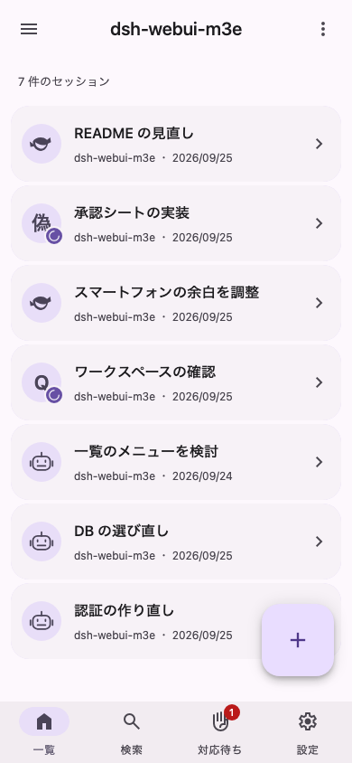
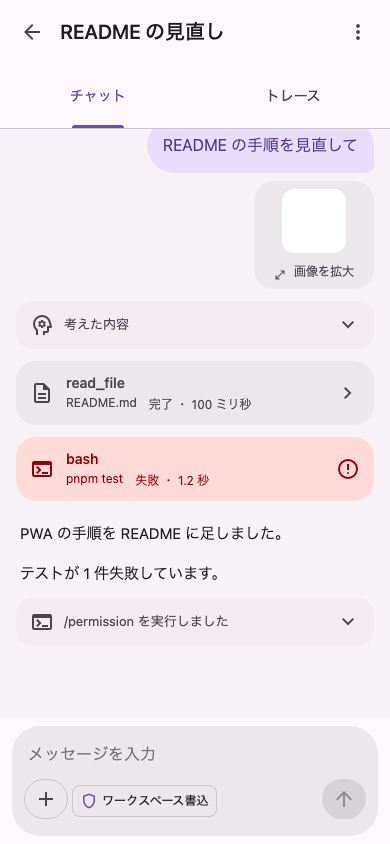
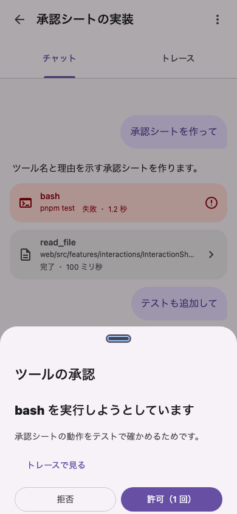
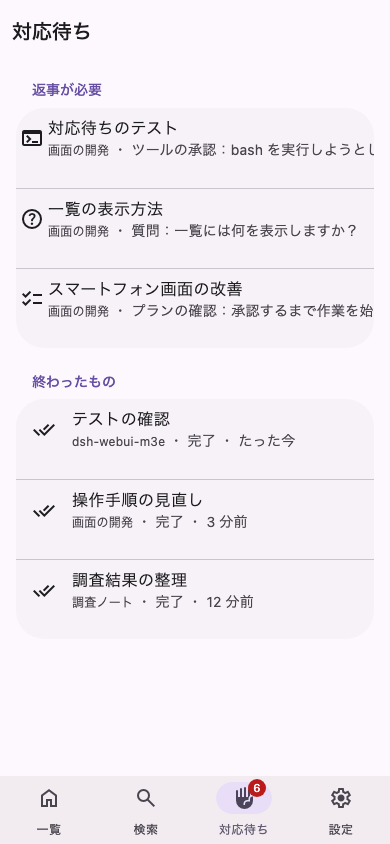

# dsh-webui-m3e

日本語 | [English](README.en.md) | [简体中文](README.zh-CN.md)

DeepSeek Harness（DSH）を、スマートフォンで使いやすい Material 3 Expressive の画面で操作するためのプラグインです。

<p>
  
  
  
  
</p>

> [!NOTE]
> 個人のプロジェクトで、DeepSeek の公式のものではありません。開発中であり、不具合がある可能性があります。ご利用には十分ご注意ください。

## Quick Start

> [!IMPORTANT]
> いま配布している 0.0.8 は **DSH 0.2.0-rc.2 用**です。**DSH 0.2.1-rc.2 に対応したリリースはまだありません**（次のリリースから対応します）。0.0.8 は DSH 0.2.1-rc.2 では動きません。DSH 0.2.0-rc.2 を使い続ける場合の戻し先も 0.0.8 です。

1. DSH が動いている端末で、次のコマンドを実行します。

   ```bash
   dsh plugin --profile web add https://github.com/AliceSaikawa/dsh-webui-m3e/releases/download/v0.0.8/dsh-webui-m3e-0.0.8.tgz
   ```

   `web` は例なので、実際に Web 画面を動かしているプロファイルを指定してください（名前を間違えても新しいプロファイルが作られるだけで、追加に成功しても接続先が正しいとは限りません）。

2. `dsh web` が表示したログイン用の URL を開き、標準画面にログインします。

3. 同じアドレスで `http://<host>/m3e/` を開きます。404 になるときは、そのプロファイルの Host を再起動します。

M3E は npm レジストリに公開していないため、名前だけの `add dsh-webui-m3e` では導入できません。追加で導入する実行時の依存パッケージはなく、M3E のソース取得・ビルド・開発依存の導入も不要です。更新・旧版への復帰では Host のコードを切り替えるため、必ず Host を再起動してください。

## できること

- **会話**：AI の返事、ツールの実行結果、考えた内容を、スマートフォンの幅で読めます。時間の順に並べた「トレース」に切り替えられます。
- **返事**：ツールの承認、AI からの質問、プランの確認に、どの画面にいても下から出るシートで答えられます。
- **対応待ち**：返事が必要な会話と、終わった会話をまとめて見られます。
- **入力**：画像の添付、`@` でのファイル参照、`/` でのコマンド候補、モデルと考える深さ、権限のプリセット、計画モードを操作できます。
- **セッションの道具**：会話のメニューから、統計、ファイル、ジョブ、サブエージェント、ゴールを開けます。
- **検索**：会話を検索できます。
- **設定**：DSH の設定、API キー、カスタムプロバイダー、この端末の外観（明暗）を扱えます。
- **ホーム画面**：iPhone の Safari から「ホーム画面に追加」すると、アプリのように開けます。

今の DSH の画面はそのまま残ります。端末ごとに、どちらの画面を使うかを選べます。

## 必要なもの

- DeepSeek Harness **0.2.1-rc.2**
  - 0.2.0-rc.2 と 0.1.5 系への対応は外しました。0.2.0-rc.2 を使い続ける場合の配布版は 0.0.8 です。確認結果、既知の差、未検証の経路は [docs/dsh-compatibility.md](docs/dsh-compatibility.md) にあります。
  - DSH 本体を入れるときは版を付けます。npm の `latest` タグは 0.2.0-rc.2 のままで、版を付けないと対応版とずれます（`@next` は将来指す版が変わるので使いません）。

    ```bash
    npm i -g @deepseek-ai/dsh@0.2.1-rc.2
    ```

    手元の版は `dsh --version` で確かめられます。DSH 0.2.0-rc.2 を使う場合は `npm i -g @deepseek-ai/dsh@0.2.0-rc.2` とします。
- DSH と pnpm の要件を満たす Node.js、および PATH 上の pnpm（通常の npm インストール版 DSH CLI が使います）。
  - DSH 自身には Node の下限宣言がありませんが、CLI が使う commander 15 は Node `>=22.12.0`、pnpm 11.17.0 は `>=22.13` を要求します。DSH と使用する pnpm の両方を満たす Node を用意してください。
- 動作確認環境は macOS 27.2、Node.js 26.7.0、pnpm 11.17.0 です。依存側の下限宣言を M3E の動作保証の下限とはしていません。
- Desktop 版はこの版・この環境では確かめていません。[上流の同梱 pnpm の説明](https://github.com/deepseek-ai/deepseek-harness/blob/master/apps/desktop/README.md#bundled-command-runtime)はありますが、通常の CLI の確認結果と区別してください。

## 使い方

1. 標準画面で一度ログインします（`dsh web` が表示したログイン用の URL を開きます）。
2. `http://<host>/m3e/` を開きます。
3. iPhone では、Safari の共有メニューから「ホーム画面に追加」すると、アプリのように開けます。

### 画面を切り替える

この端末でどちらの画面を使うかは、次のどれかで選べます。選んだ内容は端末ごとに保存されます。

- 標準画面の「設定 → 一般 → この端末で M3E の画面を使う」
- この画面の「設定 → 今の画面に戻す」
- URL に `?ui=m3e` か `?ui=classic` を付けて開く

どちらかの画面がうまく開かないときは、`http://<host>/?ui=classic` を開くと標準画面に戻れます。

## 更新・版の確認・削除

入っている版は JSON の `dependencies.dsh-webui-m3e.version`、取得元は `resolved` で確認します。

```bash
dsh plugin --profile web list dsh-webui-m3e --depth 0 --json
```

更新は、[リリースの一覧](https://github.com/AliceSaikawa/dsh-webui-m3e/releases)から対応する版を選び、その添付 tgz の URL で追加し直します。URL の形は `https://github.com/AliceSaikawa/dsh-webui-m3e/releases/download/v<version>/dsh-webui-m3e-<version>.tgz` です。次は 0.0.8 への移行例です。ローカル tgz 版を使っている人も同じプロファイルで実行し、Host を再起動して上の一覧を確認してください。版番号の手編集は不要です。

```bash
dsh plugin --profile web add https://github.com/AliceSaikawa/dsh-webui-m3e/releases/download/v0.0.8/dsh-webui-m3e-0.0.8.tgz
```

将来の新版から戻す場合も、リリースの一覧から確認済みの互換版の URL を選んで追加し直し、Host を再起動します。0.0.8 に戻す場合は同じコマンドです。以前配布した 0.0.7 と DSH 0.2.0-rc.2 の組合せは復帰先にしないでください。手元に保管した互換版の tgz に戻す形は次のとおりです。

```bash
dsh plugin --profile web add file:/path/to/dsh-webui-m3e-<version>.tgz
```

削除する前に標準画面（`http://<host>/?ui=classic`）を開きます。削除後は `/m3e/` が 404 になるので、標準画面を使います。

```bash
dsh plugin --profile web remove dsh-webui-m3e
```

うまくいかないときは、次の点を確認します。

- 取得時に 404 なら、リリースの一覧でタグ・添付ファイル名・URL を確認します。
- pnpm が見つからないなら、PATH を確認します。
- 画面に現れないなら、プロファイルと Host の再起動を確認します。
- 失敗時には CLI が診断ログの場所も表示します。

ソースからビルドする場合は [開発・配布の手順](docs/development.md#配布)を参照してください。

## 注意

- 画面の文言は今のところ日本語だけです。言語は DSH の言語設定に従う土台（[docs/design/11-i18n.md](docs/design/11-i18n.md)）はありますが、英語と中国語の訳はまだ入っていません。
- DSH の内部のライブラリ（`@deepseek-ai/cordis`、`@deepseek-ai/dsh-client-store`）を同梱しているので、DSH の版によっては動かないことがあります。
- 実機での確認は iPhone 17 Pro Max の Safari だけで行っています。ほかの端末・ブラウザは確認していません。
- 画面の試験は主に偽のデータで行い、DSH とのつながりは隔離した実物の DSH と偽の LLM で確かめています。確認の範囲は [docs/dsh-compatibility.md](docs/dsh-compatibility.md) にあります。
- 開発の方法と仕組み、検証の記録は [docs/development.md](docs/development.md) にあります。

## ライセンス

MIT です。[LICENSE](LICENSE) を見てください。
