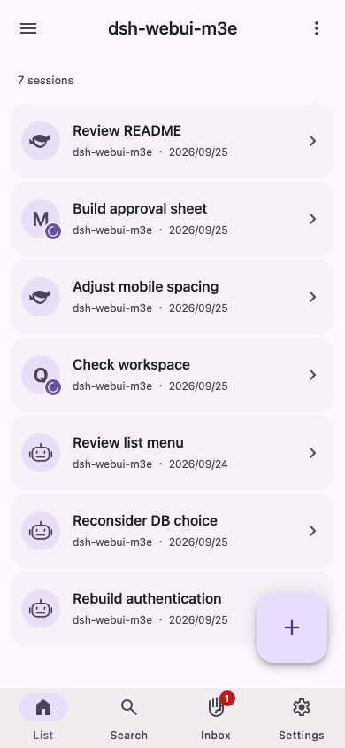
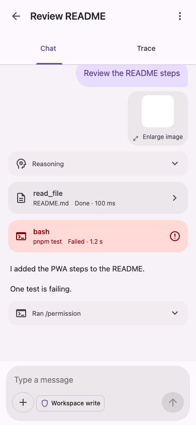
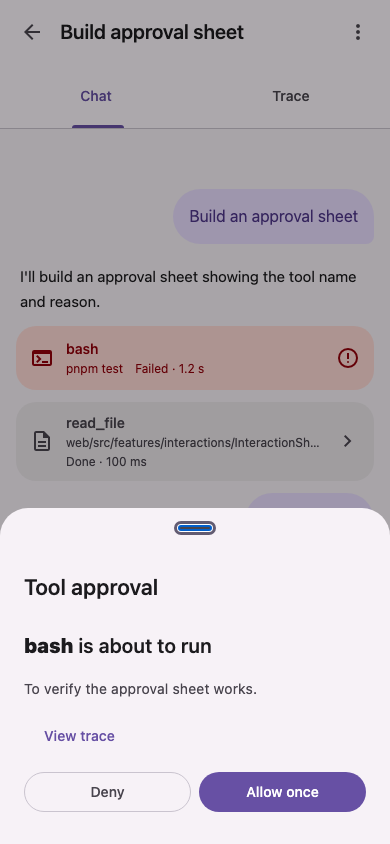
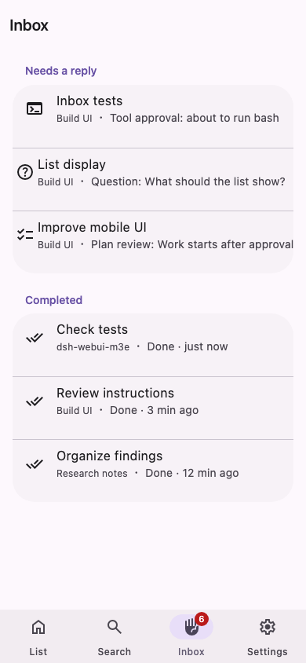

# dsh-webui-m3e

[日本語](README.ja.md) | English | [简体中文](README.zh-CN.md)

A Material 3 Expressive (M3E) mobile Web UI plugin for DeepSeek Harness (DSH), so you can use DSH comfortably on a phone.

<p>
  
  
  
  
</p>

The screenshots show mock screens. The app UI is shown in Japanese, English, or Simplified Chinese.

> [!NOTE]
> This is a personal project and is not an official DeepSeek product. It is under development and may contain bugs. Please use it with care.

## Quick Start

> [!IMPORTANT]
> The published release **0.0.9** (GitHub Latest) is built for **DSH 0.2.1-rc.2**. Install DSH 0.2.1-rc.2 with `npm i -g @deepseek-ai/dsh@0.2.1-rc.2` and check it with `dsh --version`. **0.0.8 is for DSH 0.2.0-rc.2 only** and does not run on 0.2.1-rc.2. If you stay on DSH 0.2.0-rc.2, install [v0.0.8](https://github.com/AliceSaikawa/dsh-webui-m3e/releases/tag/v0.0.8) instead.

1. Run this on the machine running DSH:

   ```bash
   dsh plugin --profile web add https://github.com/AliceSaikawa/dsh-webui-m3e/releases/download/v0.0.9/dsh-webui-m3e-0.0.9.tgz
   ```

   `web` is an example, so select the profile that actually serves your Web UI (a misspelled name still creates a new profile, and a successful install alone does not confirm the target).

2. Open the sign-in URL printed by `dsh web` to sign in to the standard interface (DSH's own Web UI).

3. Open `http://<host>/m3e/` on the same address. If it returns 404, restart that profile's Host. Restarting the Host (stop `dsh web` with Ctrl+C and start it again with the same command) can change the sign-in URL, so repeat from step 2.

M3E is not published to the npm registry, so installing by name with `add dsh-webui-m3e` is unavailable. M3E has no additional runtime packages to install, and you do not need its source, a local build, or its development dependencies. Always restart the Host after an update or rollback, because that switches the Host code between versions.

## Features

> [!NOTE]
> This section describes 0.0.9 and main. 0.0.8 does not have pinning, archived-session display and restore, base color selection, the plugin list, the shared error screens, or the Modes page in Settings.

- **Conversations:** Read AI responses, tool results, and reasoning at phone width. You can also switch to a chronological trace view (「トレース」 in the app).
- **Session list:** Pin conversations to the top of the list. Pins are shared across all workspaces, and changes made in the standard interface or on other devices are reflected too. You can show archived conversations by switching the list filter, and restore one from the long-press menu.
- **Responses:** Approve tools, answer AI questions, and review plans from a bottom sheet, whatever screen you are on.
- **Inbox:** See conversations that need a response together with completed conversations.
- **Composer:** Attach images, reference files with `@`, get command suggestions with `/`, and switch models, reasoning effort, permission presets, and plan mode.
- **Session tools:** Open stats, files, jobs, subagents, and goals from the conversation menu.
- **Search:** Search conversations.
- **Settings:** Manage DSH settings, API keys, and custom providers. The Modes page (「モード」 in the app) lists the agent presets and lets you pick the one used for new conversations.
- **Workspaces:** Switch workspaces from the drawer in the session list.
- **Appearance:** Besides light and dark, choose the base color on each device from six presets (purple, blue, teal, green, orange, red) or any color. The chosen color is applied to the whole interface.
- **Plugins:** From Settings, check the state of installed plugins in a read-only list.
- **Errors:** A shared screen explains the cause and the next action for render failures, unknown screens, conversations that fail to open, and being offline at startup.
- **Home screen:** On iPhone, choose "Add to Home Screen" in Safari to open it like an app. Behavior as a Web app added to the Home Screen is not verified.

The existing DSH interface remains available. You can choose which interface to use on each device.

## Requirements

- DeepSeek Harness **0.2.1-rc.2** (published 0.0.9 and this repository's main)
  - Use 0.0.9 with this version. See Quick Start for installation. Support for the 0.1.5 series has been removed.
  - See [docs/dsh-compatibility.md](docs/dsh-compatibility.md) (Japanese) for results, known differences, and unverified paths.
  - Install DSH itself with an explicit version. npm dist-tags such as `latest` and `next` move over time (on 2026-10-20 both pointed to 0.2.1-rc.2), so pin the version that this repository supports.

    ```bash
    npm i -g @deepseek-ai/dsh@0.2.1-rc.2
    ```

    Check your installed version with `dsh --version`.
- DeepSeek Harness **0.2.0-rc.2** (when using 0.0.8)
  - Use [v0.0.8](https://github.com/AliceSaikawa/dsh-webui-m3e/releases/tag/v0.0.8) with this version. 0.0.9 does not run on 0.2.0-rc.2.
- Node.js that meets DSH's and pnpm's requirements, and pnpm on PATH (used by the regular npm-installed DSH CLI).
  - DSH itself declares no minimum Node version, but its CLI dependency commander 15 requires Node `>=22.12.0`, and pnpm 11.17.0 requires `>=22.13`. Use Node that meets both DSH's and your pnpm version's requirements.
- The tested environment is macOS 27.2, Node.js 26.7.0 and pnpm 11.17.0; those dependency declarations do not establish M3E's minimum supported Node version.
- The DSH Desktop app has not been verified for this release in this environment. There is an [upstream bundled-pnpm path](https://github.com/deepseek-ai/deepseek-harness/blob/master/apps/desktop/README.md#bundled-command-runtime), but keep it separate from the regular CLI results.

## Usage

Installation, signing in to the standard interface, and opening `http://<host>/m3e/` are covered in Quick Start.

On iPhone, choose "Add to Home Screen" from Safari's Share menu to open it like an app. On a real device, only opening it in Safari has been confirmed; behavior as a Web app added to the Home Screen is not verified.

### Switching interfaces

In this README, the "standard interface" is DSH's own Web UI (the URL parameter and the setting call it "classic"). Choose which interface to use on this device with any of the following options. Your choice is saved separately on each device.

- In the standard interface: `Settings → General → Use the M3E interface on this device` (the row follows the standard interface's language)
- In this interface: `Settings → Return to the standard screen`
- Add `?ui=m3e` or `?ui=classic` to the URL

On a device where you chose M3E, newly opening `/` on a phone switches to M3E. On a computer (where the main input is a mouse or trackpad), `/` stays on the standard interface; open `/m3e/` directly to use M3E. On devices such as Windows Firefox with a touchscreen, the main input may not be detected as a computer, so `/` may still move to `/m3e/` as on a phone. If you remove `/m3e/` from the URL in a tab that was showing M3E and open `/`, that tab stays on the standard interface. A newly opened tab follows the setting on a phone. In 0.0.8, `/` also moves to `/m3e/` on a computer, and there is no per-tab behavior that keeps a tab on the standard interface.

If either interface fails to load, open `http://<host>/?ui=classic` to return to the standard interface.

## Updates, installed version, and removal

Read `dependencies.dsh-webui-m3e.version` in the JSON output for the installed version and `resolved` for its source.

```bash
dsh plugin --profile web list dsh-webui-m3e --depth 0 --json
```

To update, choose a compatible version from the [release list](https://github.com/AliceSaikawa/dsh-webui-m3e/releases) and add its attached tgz URL. URLs follow `https://github.com/AliceSaikawa/dsh-webui-m3e/releases/download/v<version>/dsh-webui-m3e-<version>.tgz`. This example migrates to 0.0.9. Local-tgz users use the same command in the same profile, restart the Host, and check the installed version above. No manual version editing is needed.

```bash
dsh plugin --profile web add https://github.com/AliceSaikawa/dsh-webui-m3e/releases/download/v0.0.9/dsh-webui-m3e-0.0.9.tgz
```

To roll back from a future release, choose a verified compatible version's URL from the release list, add it again, and restart the Host. The same pattern returns to 0.0.9 on DSH 0.2.1-rc.2, or to [v0.0.8](https://github.com/AliceSaikawa/dsh-webui-m3e/releases/tag/v0.0.8) on DSH 0.2.0-rc.2. Do not use the previously distributed 0.0.7 as a rollback target with DSH 0.2.0-rc.2. A saved compatible tarball can also be selected:

```bash
dsh plugin --profile web add file:/path/to/dsh-webui-m3e-<version>.tgz
```

Before removing M3E, open the standard interface (`http://<host>/?ui=classic`). After removal, `/m3e/` returns 404, so use the standard interface:

```bash
dsh plugin --profile web remove dsh-webui-m3e
```

If something fails, check the following.

- A download returning 404: check the tag, asset filename and URL in the release list.
- Missing pnpm: check PATH.
- A missing UI: check the profile and restart the Host.
- Opening `/m3e/` without the cookie shows a page that asks you to reopen it from the address bar (from v0.0.9-rc.2; the page follows the browser language: Japanese, English, or Simplified Chinese, and English for any other language). If it does not open in 0.0.8, reopen the sign-in URL printed by `dsh web`.
- Failed CLI operations also print a diagnostics path.

For source builds, see the [development and distribution guide](docs/development.md#配布) (Japanese).

## Notes

- The UI is shown in Japanese, English, or Simplified Chinese. It follows DSH's language setting (Settings → General → Language, shared with the standard interface), or the browser language when nothing is set. Other languages, Traditional Chinese included, are shown in English. The English and Chinese texts are AI translations that follow the standard interface's terms ([docs/i18n/glossary.md](docs/i18n/glossary.md), Japanese).
- This plugin bundles internal DSH libraries (`@deepseek-ai/cordis` and `@deepseek-ai/dsh-client-store`), so it may not work with every DSH version.
- Real-device testing has been done only by opening it in Safari on an iPhone 17 Pro Max. Behavior as a Web app added to the Home Screen, and other devices and browsers, are not tested.
- UI tests mainly use mock data, and the DSH connection is checked with an isolated real DSH and a fake LLM. Behavior with a real LLM is not verified. See [docs/dsh-compatibility.md](docs/dsh-compatibility.md) (Japanese) for the detailed verification scope.
- See [docs/development.md](docs/development.md) (Japanese) for architecture, development instructions and verification records.

## License

MIT. See [LICENSE](LICENSE).
