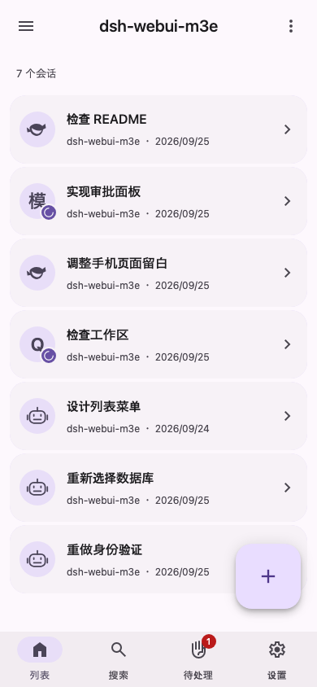
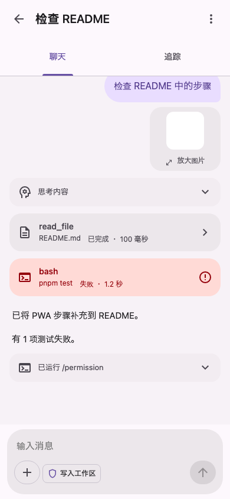
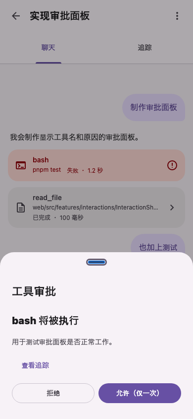
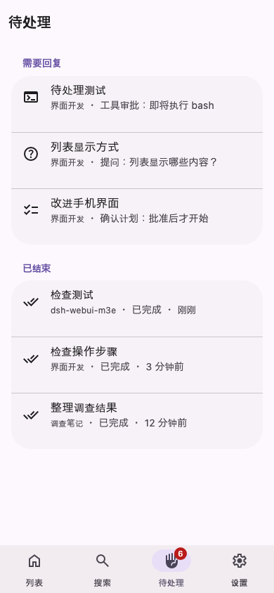

# dsh-webui-m3e

[日本語](README.md) | [English](README.en.md) | 简体中文

这是一个插件，让你在手机上通过易用的 Material 3 Expressive 界面操作 DeepSeek Harness（DSH）。

<p>
  
  
  
  
</p>

这些截图展示经过翻译的模拟画面；实际应用界面仅提供日语。

> [!NOTE]
> 这是个人项目，并非 DeepSeek 官方产品。项目仍在开发中，可能存在缺陷，请谨慎使用。

## 快速开始

1. 在运行 DSH 的机器上执行以下命令：

   ```bash
   dsh plugin --profile web add https://github.com/AliceSaikawa/dsh-webui-m3e/releases/download/v0.0.8/dsh-webui-m3e-0.0.8.tgz
   ```

   `web` 只是示例，请指定实际提供 Web 界面的配置档案（名称拼错时也只会创建新档案，安装成功并不代表目标正确）。

2. 打开 `dsh web` 输出的登录 URL，登录标准界面。

3. 用同一地址打开 `http://<host>/m3e/`。如果返回 404，请重启该配置档案的 Host。

M3E 未发布到 npm registry，因此不能只用名称执行 `add dsh-webui-m3e` 来安装。M3E 无需另外安装运行时依赖包，也无需获取源码、手动构建或安装开发依赖。更新或回退会切换 Host 代码的版本，因此必须重启 Host。

## 功能

- **会话**：在手机屏幕上阅读与 AI 的对话、工具执行结果和思考内容，也可以切换到按时间顺序排列的「トレース」（追踪）视图。
- **回复**：无论当前在哪个页面，都可以通过底部弹出的面板审批工具、回答 AI 的提问或确认计划。
- **待处理事项**：集中查看需要回复的会话和已结束的会话。
- **输入**：支持附加图片、用 `@` 引用文件、用 `/` 显示命令候选项，以及切换模型、思考深度、权限预设和计划模式。
- **会话工具**：可以从会话菜单打开统计、文件、作业、子代理和目标。
- **搜索**：搜索会话。
- **设置**：配置 DSH 的设置、API 密钥、自定义提供方，以及这台设备的外观（明暗）。
- **主屏幕**：在 iPhone 上，可以通过 Safari 的「添加到主屏幕」，像应用一样打开。

DSH 原有的界面会保留。你可以在每台设备上分别选择使用哪个界面。

## 环境要求

- DeepSeek Harness **0.2.0-rc.2**
  - 仅支持此版本。已移除对 0.1.5 系列的支持。验证结果、已知差异和未验证的操作见 [docs/dsh-compatibility.md](docs/dsh-compatibility.md)（日文）。
- 满足 DSH 和 pnpm 要求的 Node.js，以及 PATH 中的 pnpm（供通过 npm 安装的普通 DSH CLI 使用）。
  - DSH 本身未声明 Node 版本下限，但 CLI 使用的 commander 15 要求 Node `>=22.12.0`，pnpm 11.17.0 要求 `>=22.13`。请使用同时满足 DSH 和所用 pnpm 版本要求的 Node。
- 验证环境为 macOS 27.2、Node.js 26.7.0 和 pnpm 11.17.0；依赖声明的下限不代表 M3E 保证支持的最低版本。
- 本版本尚未在此环境中验证 Desktop。虽然有[上游关于内置 pnpm 的说明](https://github.com/deepseek-ai/deepseek-harness/blob/master/apps/desktop/README.md#bundled-command-runtime)，但请与普通 CLI 的验证结果区分开。

## 使用方法

1. 先登录一次标准界面（打开 `dsh web` 输出的登录 URL）。
2. 打开 `http://<host>/m3e/`。
3. 在 iPhone 上，可以通过 Safari 的分享菜单选择「添加到主屏幕」，像应用一样打开。

### 切换界面

你可以通过以下任一方式选择这台设备使用的界面。所选设置会分别保存在每台设备上。

- 在标准界面中选择「設定 → 一般 → この端末で M3E の画面を使う」（设置 → 常规 → 在此设备上使用 M3E 界面）
- 在本界面中选择「設定 → 今の画面に戻す」（设置 → 返回标准界面）
- 在 URL 后附加 `?ui=m3e` 或 `?ui=classic` 后打开

如果某个界面无法正常打开，请访问 `http://<host>/?ui=classic`，返回标准界面。

## 更新、版本确认与卸载

查看 JSON 输出中的 `dependencies.dsh-webui-m3e.version` 确认已安装版本，`resolved` 则显示来源。

```bash
dsh plugin --profile web list dsh-webui-m3e --depth 0 --json
```

更新时，从[发布列表](https://github.com/AliceSaikawa/dsh-webui-m3e/releases)选择兼容版本，用其 tgz 附件的 URL 重新添加。URL 格式为 `https://github.com/AliceSaikawa/dsh-webui-m3e/releases/download/v<version>/dsh-webui-m3e-<version>.tgz`。下面是迁移到 0.0.8 的示例。通过本地 tgz 安装的用户也在同一配置档案中执行此命令，重启 Host，再用上面的命令检查版本，无需手动修改版本号。

```bash
dsh plugin --profile web add https://github.com/AliceSaikawa/dsh-webui-m3e/releases/download/v0.0.8/dsh-webui-m3e-0.0.8.tgz
```

从未来的新版本回退时，从发布列表选择已验证的兼容版本的 URL，重新添加并重启 Host。回到 0.0.8 可使用同一命令。请勿将以前分发的 0.0.7 作为 DSH 0.2.0-rc.2 的回退目标。也可以使用保留的兼容 tgz：

```bash
dsh plugin --profile web add file:/path/to/dsh-webui-m3e-<version>.tgz
```

卸载前，请打开标准界面（`http://<host>/?ui=classic`）。卸载后 `/m3e/` 返回 404，请使用标准界面：

```bash
dsh plugin --profile web remove dsh-webui-m3e
```

如果遇到问题，请检查以下几点。

- 下载时遇到 404：在发布列表检查标签、附件名称和 URL。
- 找不到 pnpm：检查 PATH。
- 界面未出现：检查配置档案并重启 Host。
- CLI 失败时还会输出诊断日志位置。

从源码构建请参阅[开发与分发指南](docs/development.md#配布)（日文）。

## 注意事项

- 界面文字目前仅提供日语。虽然已有跟随 DSH 语言设置的机制（[docs/design/11-i18n.md](docs/design/11-i18n.md)），但英语和中文的译文尚未加入。
- 插件随附 DSH 的内部库（`@deepseek-ai/cordis`、`@deepseek-ai/dsh-client-store`），因此可能无法在某些 DSH 版本上运行。
- 实机验证仅在 iPhone 17 Pro Max 的 Safari 上进行。其他设备和浏览器尚未验证。
- 界面测试主要使用模拟数据，与 DSH 的连接则通过隔离的真实 DSH 和模拟 LLM 验证。详细验证范围见 [docs/dsh-compatibility.md](docs/dsh-compatibility.md)。
- 开发方法、工作原理和验证记录见 [docs/development.md](docs/development.md)。

## 许可证

采用 MIT 许可证。详见 [LICENSE](LICENSE)。
